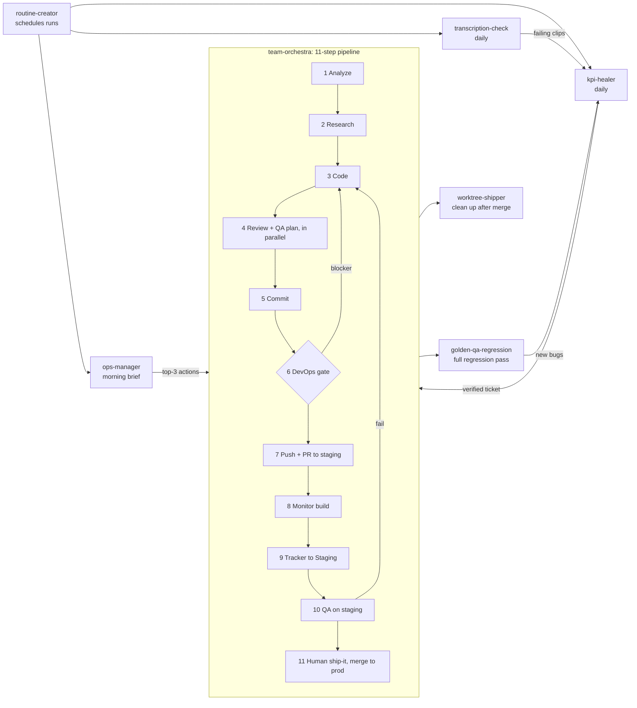

<div align="center">

# claude-skills

**Run your engineering like an ops team, from inside Claude Code.**

Seven battle-tested Claude Code skills: a morning brief, scheduled routines, self-healing KPIs,
a staged multi-agent coding pipeline, golden-reference QA, a transcript audit and safe worktree cleanup.

[](https://github.com/Shadysmetools/claude-skills/actions/workflows/validate.yml)


</div>

---

These skills grew out of daily use running a production SaaS with Claude Code as a teammate.
They share one doctrine: **evidence or it didn't happen**, agents propose and humans approve
anything irreversible, and every finding must survive an independent verifier and an adversarial
refuter before it becomes a ticket.

## Skills

| Skill | What it does | When it triggers |
|---|---|---|
| [`ops-manager`](skills/ops-manager/SKILL.md) | Runs five parallel "managers" (Flow, QA, Teacher, Continuity, Portfolio) across your projects and compiles a 2-minute morning brief with KPI deltas; a weekly retro learns from the ledger. | `/ops-manager`, "morning brief", "run the managers", or a scheduled `brief` / `retro` run |
| [`routine-creator`](skills/routine-creator/SKILL.md) | Turns any prompt or skill into a scheduled headless `claude -p` routine: wrapper script, Task Scheduler or cron entry, log and registry line. Lists and removes them too. | `/routine-creator`, "create a routine", "schedule a routine", "list my routines" |
| [`kpi-healer`](skills/kpi-healer/SKILL.md) | Self-healing KPI loop: re-verifies every open KPI issue on live data, clusters by root cause, files only verified bugs and dispatches fix agents that open PRs (never merge). | `/kpi-healer`, "heal the KPIs", or a daily routine |
| [`team-orchestra`](skills/team-orchestra/SKILL.md) | A fixed 11-step tech-lead pipeline for one ticket, with specialist subagents (full-stack, DevOps, QA, reviewer, AI, PM, UX) in parallel and hard gates before prod. | `/team-orchestra <ticket>`, "use the team", "orchestrate this" |
| [`golden-qa-regression`](skills/golden-qa-regression/SKILL.md) | Drives a real logged-in browser through a test matrix, compares each step with a golden reference, captures evidence and writes PASS/FAIL/BLOCKED and bugs back. | `/golden-qa-regression`, "run the qa regression", "qa the matrix" |
| [`transcription-check`](skills/transcription-check/SKILL.md) | Shadow-audits stored speech-to-text: ffmpeg cuts clips, Whisper is the "ears", Claude judges wrong language, translation and invented content. | `/transcription-check [date]` or a daily routine |
| [`worktree-shipper`](skills/worktree-shipper/SKILL.md) | Removes a git worktree and branch only after proving the work is committed, pushed and merged. Never forces anything. | `/worktree-shipper`, "close the worktree", "clean up worktrees after merge" |

## How the staged pipeline chains

`team-orchestra` is the hub. Routines kick things off, the pipeline ships, and the ops loop watches the result.



## Install

**Option A: copy the skills**

```sh
git clone https://github.com/Shadysmetools/claude-skills.git
cp -r claude-skills/skills/* ~/.claude/skills/
```

On Windows (PowerShell): `Copy-Item -Recurse claude-skills\skills\* $HOME\.claude\skills\`

Restart Claude Code; the skills appear under `/` and trigger on the phrases above.

**Option B: install as a plugin**

The repo ships `.claude-plugin/plugin.json` and `.claude-plugin/marketplace.json`:

```text
/plugin marketplace add Shadysmetools/claude-skills
/plugin install claude-skills@claude-skills
```

Plugin skills are namespaced, e.g. `/claude-skills:ops-manager`.

## Configure

Every skill documents its settings at the top (paths, branches, tracker, URLs, spend caps), with
safe defaults. Nothing is hard-wired to a company, host or account. Read a skill's "Configuration"
section once before its first run.

## Safety defaults

- No skill merges to production, force-pushes or deletes unmerged work.
- Anything that spends money has a per-run or per-day cap written into the skill.
- Session transcripts and fetched content are treated as untrusted data, never as instructions.

## Contributing

See [CONTRIBUTING.md](CONTRIBUTING.md). CI validates that every `SKILL.md` has `name` and
`description` frontmatter.

## License

Apache-2.0. See [LICENSE](LICENSE) and [NOTICE](NOTICE). Copyright 2026 Shady Al-Halawani.

---

⭐ If these skills save you time, star the repo so others can find it.
