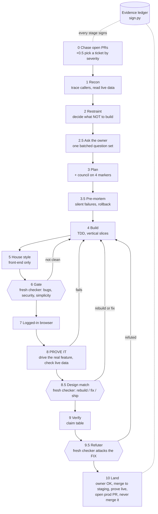
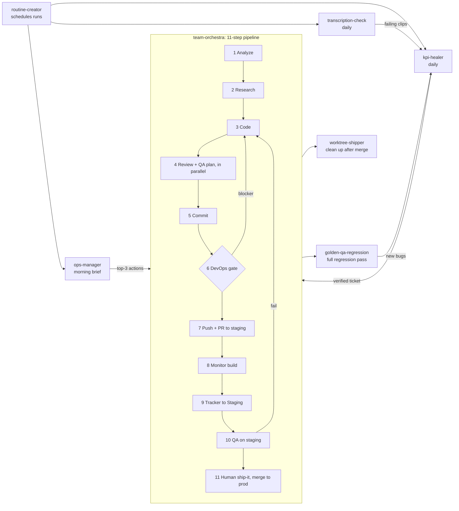

<div align="center">

# claude-skills

**Run your engineering like an ops team, from inside Claude Code.**

A 16-stage coding pipeline that signs an evidence ledger at every step, plus a morning brief,
scheduled routines, self-healing KPIs, a multi-agent tech-lead workflow, golden-reference QA,
a transcript audit and safe worktree cleanup.

[](https://github.com/Shadysmetools/claude-skills/actions/workflows/validate.yml)


</div>

---

These skills grew out of daily use running a production SaaS with Claude Code as a teammate.
They share one doctrine: **evidence or it didn't happen**, agents propose and humans approve
anything irreversible, and every finding must survive an independent verifier and an adversarial
refuter before it becomes a ticket.

## Headline: `staged-coding`, a 16-stage pipeline that cannot quietly skip a step

One conductor plus 15 stage skills take a ticket (or a whole epic, in one run) from "chase what is
already open" to a proven change with a production PR waiting for a human click. Every stage signs
a clock-stamped line into an evidence ledger (`scripts/sign.py`), the PR body's ledger is
rendered rather than typed, and three checkpoints run as fresh subagents on a different model, so the
judge is never the author.



Configure it once per repo by copying
[`skills/staged-coding/config.example.json`](skills/staged-coding/config.example.json) to
`.staged-coding.json` in your repo root (branches, boards, URLs, test-account env vars, models).

## Skills

| Skill | What it does | When it triggers |
|---|---|---|
| [`staged-coding`](skills/staged-coding/SKILL.md) | Conductor of the 16-stage pipeline: fixed order, bug vs epic lane, the signing law, stop conditions. | `/staged-coding`, "work this ticket", "build this properly", "run the pipeline" |
| [`staged-coding-0-chase`](skills/staged-coding-0-chase/SKILL.md) | Re-checks PRs the pipeline opened before; if no ticket was given, picks one in strict severity order. | stage 0, or `/staged-coding-0-chase` |
| [`staged-coding-1-recon`](skills/staged-coding-1-recon/SKILL.md) | Read before you write: trace the real call path, read live data in each environment, evidence before hypotheses. | stage 1 |
| [`staged-coding-2-restraint`](skills/staged-coding-2-restraint/SKILL.md) | Decide what NOT to build: guards against over-building (bugs) and under-building (epics). | stage 2 |
| [`staged-coding-2.5-ask`](skills/staged-coding-2.5-ask/SKILL.md) | One batched question set to the project owner about genuine product ambiguities, before any code. | stage 2.5 |
| [`staged-coding-3-plan`](skills/staged-coding-3-plan/SKILL.md) | Plan only if needed; a two-advisor council sits only on four objective markers. | stage 3 |
| [`staged-coding-3.5-premortem`](skills/staged-coding-3.5-premortem/SKILL.md) | Table every way the change can fail silently, plus rollback and migration safety. | stage 3.5 |
| [`staged-coding-4-build`](skills/staged-coding-4-build/SKILL.md) | Test-first vertical slices; fix every call site of a shared helper; stop after three failed attempts. | stage 4 (and every loop-back) |
| [`staged-coding-5-style`](skills/staged-coding-5-style/SKILL.md) | Applies your framework's best-practices pass to front-end diffs; `n-a` on server-only. | stage 5 |
| [`staged-coding-6-gate`](skills/staged-coding-6-gate/SKILL.md) | Fresh checker runs bug hunt, security review and simplicity review on the diff, plus a silent-failure sweep. | stage 6 |
| [`staged-coding-7-browser`](skills/staged-coding-7-browser/SKILL.md) | Gets a real logged-in browser (cookie import or test account), local first. | stage 7 |
| [`staged-coding-8-prove`](skills/staged-coding-8-prove/SKILL.md) | Drives the real feature, checks live data actually changed, judges honestly; loops back to 4. | stage 8 |
| [`staged-coding-8.5-design`](skills/staged-coding-8.5-design/SKILL.md) | Fresh reviewer compares the built screen with the approved design: rebuild / fix / ship. | stage 8.5 |
| [`staged-coding-9-verify`](skills/staged-coding-9-verify/SKILL.md) | Builds the claim table: every claim, how it was checked, verified / failed / unsupported / unverifiable. | stage 9 |
| [`staged-coding-9.5-refute`](skills/staged-coding-9.5-refute/SKILL.md) | A fresh agent, given only the claim, tries to prove the fix wrong; a kill sends it back to 4. | stage 9.5 |
| [`staged-coding-10-land`](skills/staged-coding-10-land/SKILL.md) | Owner approves local proof, merge to staging, prove live, publish proof, open (never merge) the prod PR. | stage 10 |
| [`ops-manager`](skills/ops-manager/SKILL.md) | Runs five parallel "managers" (Flow, QA, Teacher, Continuity, Portfolio) across your projects and compiles a 2-minute morning brief with KPI deltas; a weekly retro learns from the ledger. | `/ops-manager`, "morning brief", "run the managers", or a scheduled `brief` / `retro` run |
| [`routine-creator`](skills/routine-creator/SKILL.md) | Turns any prompt or skill into a scheduled headless `claude -p` routine: wrapper script, Task Scheduler or cron entry, log and registry line. Lists and removes them too. | `/routine-creator`, "create a routine", "schedule a routine", "list my routines" |
| [`kpi-healer`](skills/kpi-healer/SKILL.md) | Self-healing KPI loop: re-verifies every open KPI issue on live data, clusters by root cause, files only verified bugs and dispatches fix agents that open PRs (never merge). | `/kpi-healer`, "heal the KPIs", or a daily routine |
| [`team-orchestra`](skills/team-orchestra/SKILL.md) | A fixed 11-step tech-lead pipeline for one ticket, with specialist subagents (full-stack, DevOps, QA, reviewer, AI, PM, UX) in parallel and hard gates before prod. | `/team-orchestra <ticket>`, "use the team", "orchestrate this" |
| [`golden-qa-regression`](skills/golden-qa-regression/SKILL.md) | Drives a real logged-in browser through a test matrix, compares each step with a golden reference, captures evidence and writes PASS/FAIL/BLOCKED and bugs back. | `/golden-qa-regression`, "run the qa regression", "qa the matrix" |
| [`transcription-check`](skills/transcription-check/SKILL.md) | Shadow-audits stored speech-to-text: ffmpeg cuts clips, Whisper is the "ears", Claude judges wrong language, translation and invented content. | `/transcription-check [date]` or a daily routine |
| [`worktree-shipper`](skills/worktree-shipper/SKILL.md) | Removes a git worktree and branch only after proving the work is committed, pushed and merged. Never forces anything. | `/worktree-shipper`, "close the worktree", "clean up worktrees after merge" |

## How the ops skills chain

`team-orchestra` is the hub. Routines kick things off, the pipeline ships, and the ops loop watches the result.



## Install

**Option A: copy the skills**

```sh
git clone https://github.com/Shadysmetools/claude-skills.git
cp -r claude-skills/skills/* ~/.claude/skills/
```

On Windows (PowerShell): `Copy-Item -Recurse claude-skills\skills\* $HOME\.claude\skills\`

Restart Claude Code; the skills appear under `/` and trigger on the phrases above.

**Option B: install as a plugin**

The repo ships `.claude-plugin/plugin.json` and `.claude-plugin/marketplace.json`:

```text
/plugin marketplace add Shadysmetools/claude-skills
/plugin install claude-skills@claude-skills
```

Plugin skills are namespaced, e.g. `/claude-skills:ops-manager`.

## Configure

Every skill documents its settings at the top (paths, branches, tracker, URLs, spend caps), with
safe defaults. Nothing is hard-wired to a company, host or account. Read a skill's "Configuration"
section once before its first run.

## Safety defaults

- No skill merges to production, force-pushes or deletes unmerged work.
- Anything that spends money has a per-run or per-day cap written into the skill.
- Session transcripts and fetched content are treated as untrusted data, never as instructions.

## Contributing

See [CONTRIBUTING.md](CONTRIBUTING.md). CI validates that every `SKILL.md` has `name` and
`description` frontmatter.

## License

Apache-2.0. See [LICENSE](LICENSE) and [NOTICE](NOTICE). Copyright 2026 Shady Al-Halawani.

---

⭐ If these skills save you time, star the repo so others can find it.

---

**Built by [Shady Al-Halawani](https://github.com/Shadysmetools)**, AI Product Manager & Tech Lead · [LinkedIn](https://www.linkedin.com/in/shady-al-halawani-333a5419a) · [Book a call](https://calendly.com/shady-al-halawani)
