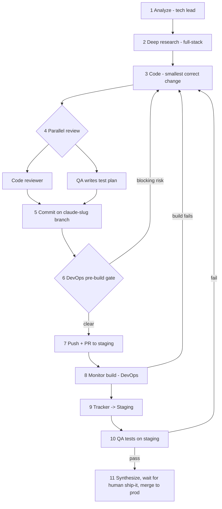

# /team-orchestra: staged tech-lead pipeline

The main agent acts as **tech lead** and the only decision-maker. Specialist subagents are spawned
in parallel wherever the work allows. The lifecycle is fixed; deviating needs an explicit user override.

## Configuration (ask once, or read from the repo's CLAUDE.md)

| Setting | Example |
|---|---|
| `STAGING_BRANCH` | `staging` (code lands here first) |
| `PROD_BRANCH` | `main` |
| `BRANCH_PREFIX` | `claude-` (feature branches: `claude-<slug>`) |
| `STAGING_URL` | `https://staging.example.com` |
| Tracker | GitHub issues/projects, Jira, Linear... with stages: Planning -> In Progress -> Staging -> Ready for Prod -> Prod Review -> Done |
| `PROD_APPROVER` | the human who says "ship it" |

## Input

`/team-orchestra <ticket-id-or-description>`, e.g. `/team-orchestra 42` or
`/team-orchestra fix the upload retry path`.

No argument: pull the next-priority ticket from the tracker, preferring Staging -> Ready for Prod ->
In Progress -> Planning (owned by the user, overdue first).

## The roles

| # | Role | Focus |
|---|---|---|
| 1 | Senior full-stack developer | architecture or root cause; writes the change |
| 2 | Senior DevOps | pre-ship risk (memory, migrations, env vars, rollback) and live build watching |
| 3 | QA tester | expanded staging test plan, then runs it |
| 4 | Code reviewer | missed call sites, edge cases, regressions |
| 5 | AI engineer | LLM / RAG / embedding pipelines, if touched |
| 6 | Product manager | spec, acceptance criteria, user impact |
| 7 | UX/UI designer | design spec (tokens, layout) vs a named reference UI; no code |

The tech lead picks the roles per ticket. Most tickets need three, not seven. If you have skills
for a role (e.g. `systematic-debugging`, `code-review`, `security-review`), tell the agent to load
that skill first.

## Briefing each subagent

Every subagent gets, at minimum:
1. **The ticket**: title, description, stage, owner.
2. **Relevant memory/docs pointers** for its role (codebase map, known bugs, infra notes, coding standards).
3. **Latest code state**: read the actual files (or `gh api` them). Never assume from memory.
4. **Permission to fetch from the internet** when it needs vendor docs or prior art.
5. **Its skill to invoke first**, if one exists.
6. **A tight report format**: Approval / Risk / Findings / Recommendations, under N words.

## The fixed 11-step lifecycle



| Step | Owner | What happens |
|---|---|---|
| 1 | Tech lead | **Analyze**: read the ticket and linked sources; decide which roles are needed. |
| 2 | Full-stack or tech lead | **Deep research**: read the relevant code; pull docs/prior art when needed. |
| 3 | Full-stack | **Code**: smallest correct change, targeting `STAGING_BRANCH`. |
| 4 | Code reviewer + QA | **Review (parallel)**: reviewer sweeps for missed occurrences and edge cases; QA writes the expanded staging test plan. |
| 5 | Tech lead | **Commit** on `<BRANCH_PREFIX><slug>`. PR title prefix `fix(...)` or `feat(...)`. |
| 6 | DevOps | **Pre-build risk check**: predict OOM, required migrations, env vars, manual recovery steps. **GATE: no push if DevOps flags a blocker.** |
| 7 | Tech lead | **Push + open PR** to `STAGING_BRANCH` (triggers your staging deploy). |
| 8 | DevOps | **Monitor build**: tail CI; watch for known failure signatures; confirm the service restarted healthy. |
| 9 | Tech lead | **Tracker -> Staging**; replace a stale description with concrete findings and the PR link. |
| 10 | QA | **Test on `STAGING_URL`** with the expanded plan. Report pass/fail with evidence. |
| 11 | Tech lead | **Synthesize, then wait for `PROD_APPROVER`'s "ship it"**; merge to `PROD_BRANCH`; tracker -> Prod Review. Only the human marks Done. |

## Hard rules
1. **Tech lead stays in the loop.** Conductor, not dispatcher. After every subagent returns,
   synthesize and decide. Route follow-ups to existing agents (`SendMessage`) instead of spawning fresh ones.
2. **Parallel by default.** Spawn QA + reviewer + DevOps in the same message; they read different surfaces.
3. **Pre-flight gate.** DevOps approval is required before fast-forwards, force-pushes, migrations or production merges.
4. **Tech lead decides.** Subagent outputs are advisory; the tech lead reconciles disagreements.
5. **Staging first.** All code lands on `STAGING_BRANCH` first; production only after the human's explicit "ship it".
6. **No direct production merges** except documented emergencies (rollbacks, hotfixes for live incidents). When in doubt, ask.
7. **Tracker sync at every stage transition.** The tech lead writes the transitions; only the human marks Done.

## Output format

```
## Ticket: #<id> - <title>
Stage: <current> -> target: <next>
Owner: <name>

## Team for this ticket
1. <role> -> <skill or focus>
...

## Lifecycle progress
- [x] step 1
- [ ] step 2
...
```

After each subagent returns, post a short synthesis with the tech-lead decision before moving on.

## Don't
- Don't auto-merge PRs. The tech lead opens them; the human merges to production.
- Don't skip the DevOps pre-flight, even for "tiny" changes; tiny changes cascade.
- Don't run all roles when three suffice.
- Don't let subagents free-form. Always give a report format and a word budget.
- Don't lose track of running agents. If 3 are running and 2 return, wait for the third before
  claiming "the team reported in".
- When the ticket is done and merged, use `worktree-shipper` to clean up its worktree.
